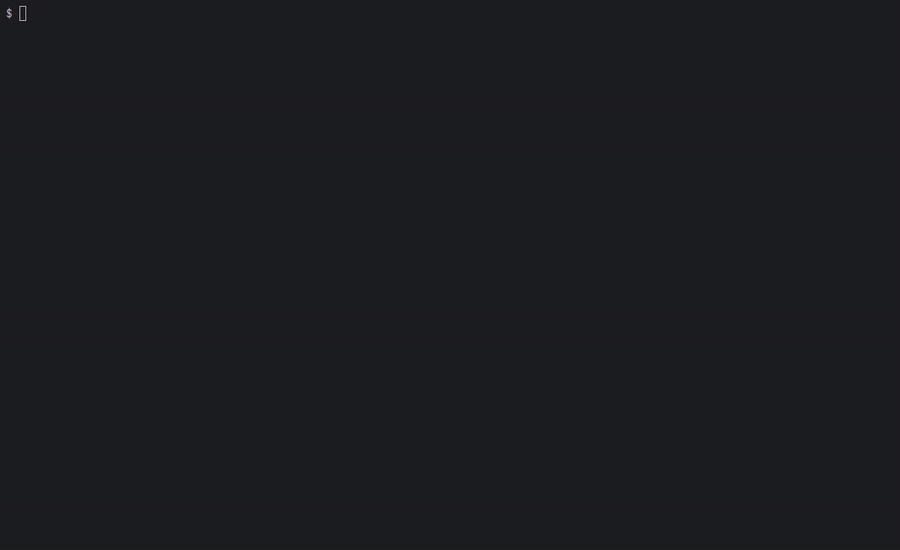

# termpicv

A terminal image browser: a thumbnail grid and a full-screen viewer, drawn with ncurses, with the images
displayed by [ueberzug](https://github.com/ueberzug/ueberzug) or [ueberzugpp](https://github.com/jstkdng/ueberzugpp).



## Features

- **Thumbnail grid** with filenames and a highlighted selection, centered in the terminal; six thumbnail sizes.
- **Full-screen viewer** with the path, pixel dimensions, file size and position shown in the header.
- **Cached thumbnails** generated in a background thread (visible ones first) and stored in
  `~/.cache/termpicv`; a thumbnail is regenerated when its file changes.
- **Animated GIF and WebP playback** in the viewer, starting as soon as the first frames are decoded, with
  per-frame delays from the file. When ueberzug can't keep up, frames are dropped so playback stays in real time.
- **Aspect-correct, centered images** when the terminal reports its pixel size.
- **Vim-style and arrow-key navigation**, paging, first/last jumps.
- **Resilient ueberzug handling**: only changed images are re-sent, and ueberzug is restarted if it crashes.
- Formats: jpg, jpeg, png, gif, bmp, webp, tif, tiff, avif, heic, jxl, ico, ppm, tga (whatever your ueberzug
  backend can load).

## Requirements

- A C++20 compiler and CMake ≥ 3.16
- ncurses (wide-char build)
- `ueberzugpp` or `ueberzug` on the `PATH`
- Optional, recommended: ImageMagick (Magick++) and libpng, for cached thumbnails and GIF/WebP animation

On Arch Linux:

```sh
pacman -S cmake ncurses imagemagick libpng ueberzugpp   # or: ueberzug
```

## Build

```sh
cmake -B build
cmake --build build
sudo cmake --install build   # optional, installs to /usr/local/bin
```

Build without ImageMagick with `cmake -B build -DTERMPICV_USE_MAGICK=OFF`: ueberzug then loads the full-size
images directly for thumbnails (slower on large folders), and GIFs show their first frame only.

## Usage

```sh
termpicv                     # browse images in the current directory
termpicv ~/Pictures          # browse a directory
termpicv -r ~/Pictures       # ... recursively
termpicv a.jpg b.png dir/    # browse a mix of files and directories
termpicv photo.jpg           # open photo.jpg in the viewer, with the rest of its directory around it
```

| Option | |
| --- | --- |
| `-r`, `--recursive` | scan directories recursively |
| `-h`, `--help` | show help |

## Keys

### Grid

| Key | Action |
| --- | --- |
| `h` `j` `k` `l` / arrows | move selection |
| `PgUp` `PgDn`, `Ctrl-U` `Ctrl-D`, `Ctrl-B` `Ctrl-F` | page up / down |
| `g` / `Home`, `G` / `End` | first / last image |
| `+` / `=`, `-` | bigger / smaller thumbnails |
| `Enter`, `Space`, `o` | open in viewer |
| `Ctrl-L` | redraw |
| `q` | quit |

### Viewer

| Key | Action |
| --- | --- |
| `l` `j` `n` `Space` / `→` `↓` `PgDn` | next image |
| `h` `k` `p` `Backspace` / `←` `↑` `PgUp` | previous image |
| `g` / `Home`, `G` / `End` | first / last image |
| `a` | pause / resume animation |
| `q`, `Esc`, `Enter` | back to the grid |
| `Q` | quit |

## Environment

| Variable | |
| --- | --- |
| `TERMPICV_UEBERZUG` | ueberzug binary to run (default: `ueberzugpp`, then `ueberzug`) |
| `TERMPICV_UEBERZUG_LOG` | write ueberzug's error output to this file (disables its `--silent` mode) |
| `XDG_CACHE_HOME` | thumbnail cache location (default `~/.cache`) |

Animation frames are written to a temporary directory under `$XDG_RUNTIME_DIR` (or `/tmp`), which is deleted
when you leave the image.

## License

MIT, see [LICENSE](LICENSE).
